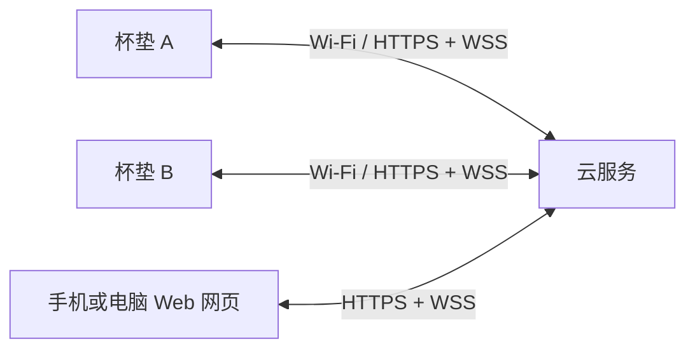

# 饮水陪伴杯垫 MVP 实施计划

更新日期：2026-10-12

推荐采用：**独立称重杯垫 + ESP32-S3 Wi-Fi 直连云端 + 手机／电脑通用 Web 网页。** 普通杯子放在杯垫上使用，先做两台 USB 供电样机，验证一对用户的饮水记录和陪伴体验。

**网页负责设置和查看，杯垫负责持续工作。** 网页关闭、手机锁屏、电脑休眠后，只要杯垫有电、网络和云服务正常，两台杯垫仍能记录和互动；断网时继续本地记录，恢复联网后补传。

当前已移除模拟运行链路，固件按用户使用的 Arduino IDE 整理为 `firmware/water_companion/water_companion.ino` 工程，包含 HX711 采样、串口配置、零点／砝码校准、空杯登记、取放识别、NVS 缓存和 Wi-Fi 上报。后端接收带设备凭证的局域网请求，网页仅显示真实上报。实际开发板为微雪 ESP32-S3-LCD-1.47B，HX711 使用单 VCC 模块、3.3 V 供电，DOUT=GP2、SCK=GP4；Arduino Serial 经 Type-C USB Serial/JTAG 收发命令。Arduino 整体编译、烧录和硬件验收待执行，详见 [固件说明](firmware/README.md)、[接线表](hardware/circuits/wiring.md)与[验收记录](docs/validation.md)。下述屏幕、双人互动等整机阶段仍是后续目标。

## 1. 首版产品：保留独立杯垫和双人陪伴



两个杯垫可以处在不同网络，不要求手机或电脑一直在线。首版完成以下闭环：

- **初始化：** 给杯垫配置 Wi-Fi，绑定账号，登记空杯重量，设置头像。
- **饮水记录：** 喝水后放回杯垫，屏幕和网页更新自己的今日估算饮水量。
- **双人配对：** 一方生成邀请码，另一方接受；每人只绑定一台杯垫、一位伙伴。
- **自然陪伴：** 检测到喝水后，对方杯垫上的头像播放举杯动作。
- **主动问候：** 短按杯垫按钮，对方看到你的头像挥手。
- **自由退出：** 可以暂停分享、静音互动或解除配对；未配对时仍能独立记录。

**默认分享头像和喝水动态，具体毫升数由本人主动开启分享。** 提醒只用屏幕表现，不加声音、排行榜和催促文案。问候最多每分钟发送一次，接收方可以关闭。

设备离线时展示最后同步时间。历史饮水记录可以补传，历史动作不补播；实时动作超过一分钟失效。单人苔藓、复杂宠物养成、多款硅胶套留到下一轮，首版只保留头像与固定动画。

## 2. 改成 Web 后，具体调整什么

| 原方案 | 调整后 | 实际影响 |
|---|---|---|
| 手机／电脑通过 BLE 连接杯垫 | 杯垫自己连接 Wi-Fi，再连接云端 | 使用时不依赖客户端常驻；需要解决配网和固件联网恢复 |
| Tauri + Vue 桌面界面，或另做微信小程序 | Vue 3 + TypeScript + Vite 响应式网页 | 手机和电脑使用同一套界面，不需要原生安装包或小程序发布流程 |
| Rust + btleplug 桌面后台 | 称重、缓存、重连和上报由 ESP32 固件承担 | 删除桌面中转层，固件承担更多可靠性工作 |
| 设备 → 电脑 SQLite → 云端 | 设备 Flash → 云端 SQLite | 设备直接等待云端持久化确认，再推进上传进度 |
| App 经 BLE 分片发送头像 | 网页上传头像，设备通过 HTTPS 下载 | 保留固定尺寸与完整性校验，传输方式改变 |
| macOS／Windows 蓝牙授权、签名和安装包 | HTTPS 网站和浏览器兼容性验收 | 首轮覆盖 iPhone Safari、Android Chrome 和桌面浏览器 |

**不把 Web Bluetooth 作为主连接方案。** Chrome 支持部分平台，但 Safari／iOS Safari 和 Firefox 尚不支持原生 Web Bluetooth；连接还需要用户授权和操作触发。把网页做成 PWA 也不能替代设备自己的持续联网能力。依据：[Chrome 官方说明](https://developer.chrome.com/docs/capabilities/bluetooth)、[MDN 兼容性数据](https://github.com/mdn/browser-compat-data/blob/main/api/Bluetooth.json)。

普通 Web 网页先完成全部核心功能；添加到主屏幕、离线页面缓存和网页推送都不作为首版依赖。网页不在前台时，陪伴反馈由杯垫屏幕承担。

这条路线的前提是使用地点允许杯垫接入 **2.4 GHz Wi-Fi**。首版支持家庭路由器等普通密码网络；需要网页认证、企业账号或网管审批的办公网络须单独验证，不承诺直接支持。没有可用 Wi-Fi 时只能本地记录。

## 3. 硬件：沿用现成模块，先把称重结构做好

| 部件 | 首版选择 | 需要完成的工作 |
|---|---|---|
| 主控 | **微雪 ESP32-S3-LCD-1.47B** | 16 MB Flash、8 MB PSRAM；使用板载 Wi-Fi 与 Type-C USB 串口 |
| 称重传感器 | **2 kg 四线单点梁式传感器** | 固定底座与上盘、加过载限位，验证中心与偏心放杯的误差 |
| 称重采集 | **HX711，支持 3.3 V 供电的单 VCC 模块** | VCC 接 3V3，DOUT 接 GP2、SCK 接 GP4，先按每秒 10 次采样调试 |
| 屏幕 | **开发板自带 1.47 英寸、172×320、ST7789 SPI 彩屏** | 后续实现饮水量、头像、连接状态显示，当前固件尚未驱动 |
| 交互 | **一个实体按钮** | 短按问候，长按进入配网；按键安装在固定底座，避免影响称重 |
| 供电 | **USB 5 V 电源** | 按整机峰值电流留余量，验证 Wi-Fi 发射和亮屏同时发生时不复位 |
| 结构 | **3D 打印底座、承重上盘、独立防滑垫** | 布置屏幕、走线、隔水结构、天线空间和拆装位置 |

[ESP32-S3 官方资料](https://www.espressif.com/en/products/socs/esp32-s3)确认芯片内置 2.4 GHz Wi-Fi；[微雪开发板文档](https://docs.waveshare.net/ESP32-S3-LCD-1.47B/)列出了实际板型的存储配置与接口。称重 GPIO 已确定为 GP2/GP4；GPIO1 为板载电池检测，GPIO19/20 为 Type-C USB，不能套用旧立创板接法。

Arduino 开发板设置选择 OPI PSRAM，当前称重功能不依赖头像或显示缓冲。后续一张 172×320 RGB565 图片约占 110 KB；PSRAM 不等于所有联网内存都充裕，需要在亮屏、下载头像和 TLS 连接并行时测内存余量。

结构沿用“后方承重圆盘 + 前方倾斜屏幕”：

- 传感器两端按所选型号的安装要求分别固定，载荷经过传感器；上盘与固定外壳之间留活动间隙。
- 硅胶、线缆和外壳不能跨接承重上盘与底座而分担重量；限位不能在正常量程内顶住上盘。
- 屏幕和按钮位于固定底座，杯子放着也能看见；电子区域与可能积水的位置隔开。
- 称重线远离天线和高电流走线，天线周围按模块要求留空间，实测联网时的称重噪声。
- 用独立 USB 电源保证电脑休眠后杯垫仍有电。首版不加电池、加热、定制 PCB 或一体式杯身。

沿用原方案的预算占位：**材料单台约 ¥150–320，两台约 ¥300–640；首轮总预算约 ¥800–1,500**，包括砝码、工具、备件、运费和结构返工。这些不是本次核验的采购报价，暂不含服务器／域名和开发工时；下单前按实际模块和结构询价。

## 4. 软件：固件、网页、云服务三部分

| 部分 | 技术选择 | 首版必须做的内容 |
|---|---|---|
| 杯垫固件 | **Arduino ESP32；后续接入 LVGL** | HX711／屏幕／按钮驱动，称重状态机，本地事件存储，Wi-Fi 配网与重连，HTTPS 上报，WSS 收取互动，校时与状态显示 |
| Web 网页 | **Vue 3 + TypeScript + Vite** | 登录、设备初始化引导、今日与历史记录、撤销误记、头像、伙伴配对、分享设置；适配手机和电脑 |
| 云服务 | **Node.js + TypeScript + Fastify + SQLite** | 用户与设备鉴权、绑定与配对、事件去重和统计、配置同步、互动转发、头像存储 |
| 部署 | **一个支持常驻进程和持久磁盘的服务实例 + HTTPS 域名** | 提供网页、API 和 WSS，持久化数据库／头像，设置进程重启、日志和备份 |

网页和 API 优先同域部署。数据库及头像放持久目录，不能随重新部署丢失。前端静态托管本身不能替代需要设备长连接的后端。首轮不引入 MQTT Broker、Redis、微服务或独立原生客户端。

固件使用 Espressif 的 [HTTP 客户端](https://docs.espressif.com/projects/esp-idf/en/stable/esp32s3/api-reference/protocols/esp_http_client.html)和 [WebSocket 客户端](https://docs.espressif.com/projects/esp-protocols/esp_websocket_client/docs/latest/index.html)。历史事件通过 HTTPS 批量上报，WSS 用于互动、状态和配置通知；连接中断后退避重连。联网和图片下载不能阻塞称重采样、记录及按钮处理。

网页只保留四组业务页面，登录另设简单入口：

1. **首页：** 今日估算饮水量、最近记录、伙伴状态、设备在线状态和最后同步时间。
2. **记录：** 按日查看饮水与补水事件，撤销误记；始终标注为估算值。
3. **伙伴：** 邀请／接受配对、头像、动态和毫升数分享开关、静音与解除配对。
4. **设备与设置：** 首次联网指引、绑定、空杯登记、时区、重新配网指引和固件版本。

头像由网页裁剪，服务器校验文件与尺寸后转换为设备可读取的固定格式。设备下载并校验完整后再替换，失败保留旧图；举杯和挥手动画预置在固件中。私有头像下载同样校验设备及配对关系。

两名试用用户继续采用预置账号和一次性登录邀请码，登录后建立可退出、可撤销的会话，暂不建设公开注册和微信登录。每台设备单独分配随机凭证，不能把设备编号当密码，也不能把设备凭证交给网页。HTTPS／WSS 必须验证服务器证书，Wi-Fi 密码只存设备、不上传云端、不写日志或仓库。

## 5. 首次使用：把配网与账号绑定分开

**开发第一步允许通过 USB 串口写入 Wi-Fi 和设备凭证，先证明硬件与联网闭环。交给试用用户前再完成网页配网。** 两台样机的设备编号和独立凭证由开发者预置，不先做批量出厂系统。

试用版的用户操作顺序：

1. 杯垫通电；首次使用或长按按钮后，启动带独立密码的临时 Wi-Fi 热点，屏幕显示热点名、密码和本地配网页地址。
2. 用户在手机系统设置中手动连接该热点，再用系统浏览器打开杯垫提供的本地网页，例如 `http://192.168.4.1`；页面资源全部存在设备里，不依赖互联网。
3. 本地网页选择／输入家庭 Wi-Fi 名称和密码，杯垫尝试连接；密码错误时保留重试入口。配网超时自动关闭热点，长按可重试；已有有效配置不因失败尝试被直接抹掉。
4. 屏幕分别提示“Wi-Fi 已连接”和“云端已连接”；成功后关闭临时热点。用户回到正常网络，打开正式 HTTPS 网页。
5. 杯垫在线后，用户按设备提示通过实体按钮触发短时有效的一次性绑定码，登录网页输入该码完成绑定。绑定码由云端核验、限制尝试次数且只用一次；已绑定设备不能被新账号直接抢绑。
6. 按网页指引登记空杯重量、设置头像，再邀请伙伴。

这里有两个页面：**设备里的临时配网页，以及日常使用的云端网页。** 正式网页不直接跨域访问本地 HTTP 设备，也不承担切换手机 Wi-Fi 的工作。自动弹出配网页只作为后续便利功能，首版保留手动打开地址的可靠入口；微信内置浏览器不作为配网验收入口。

Espressif 支持 [SoftAP + HTTP 的配网基础能力](https://docs.espressif.com/projects/esp-idf/en/stable/esp32s3/api-reference/provisioning/protocomm.html)，但官方配网协议不等于现成的浏览器表单。首版用设备热点、HTTP Server 和自托管的小表单完成配网，需自行实现页面、参数校验与连接反馈；热点使用每台设备独立的 WPA2 密码，并只在配网窗口开放。安全设计参考[官方配网说明](https://docs.espressif.com/projects/esp-idf/en/v5.3.3/esp32s3/api-reference/provisioning/provisioning.html)。

普通断网只触发重连，不自动开放配网热点。修改 Wi-Fi 不清空饮水记录或解除绑定。首轮固件通过 USB 更新，OTA 升级留到两台样机稳定之后。

## 6. 称重：最需要真机验证的部分

**称重校准与空杯登记分开。** 组装后先用空载零点和已知砝码校准秤，再登记用户空杯重量；重启时不能把当前放着的杯子自动当成零点，也不能把初始重量当成新饮水事件。

首版状态机：

1. 过滤重量并识别稳定状态，保存取杯前的稳定值。
2. 确认杯子离开，等放回后约两秒且连续采样波动满足稳定条件，再与取杯前比较。
3. 重量下降记为估算饮水，上升记为补水；小于 5 克的变化先忽略。清水按约 1 克对应 1 毫升估算。
4. 没有完整取放过程的缓慢漂移不记饮水；手压、长时间晃动、超量程或超过原有水量等不合理变化不直接累计。
5. 网页提供撤销误记和重新登记杯子的入口；设备重连后同步更正结果，避免屏幕与网页长期显示不同总量。已经播放的伙伴动画无法撤回。

两秒和五克是待样机验证的初始参数。首版支持同一个杯子、清水、取杯后放回的使用方式。**倒水与喝水无法只靠重量区分；喝完直接补水只能测到净变化，不能还原实际喝了多少。** 吸管饮水不取杯、换杯、加冰或改变杯盖等情况不保证识别，换杯需要重新登记。

先分别测空载、标准砝码、正常取放、偏心放杯和热杯静置，再加入 Wi-Fi 传输及动画。结构受力或热漂移问题不能靠降低事件门槛掩盖。静态称重误差与单次饮水估算误差分开测，前后两次读数的误差会影响差值，尤其是小口饮水。

## 7. 同步与离线：设备不依赖网页常驻

- **先保存，再发送。** 设备只持久化事件和必要状态，不持续把原始称重采样写入 Flash；调试时可通过串口采样观察。
- **唯一标识与确认。** 事件标识在重启后也不能冲突，服务器按设备和事件标识去重。云端事务落盘后返回确认，设备才推进上传进度；丢确认后重传不能重复累计或重复播放动作。
- **事件缓存。** 设备保留至少 4,096 条事件，实际 Flash 分区和断电恢复需验证；缓存溢出要报告记录缺口，不能静默假装全部补齐。
- **校时与分日。** 联网后校时，事件保存 UTC 时间和时间是否可信，按用户时区统计。断网但未断电可继续计时；断电重启且尚未校时的事件保留启动标识和相对时间，标为时间待确认，不能全部算进重连当天，也不能拿它触发“刚喝水”动画。校时与 TLS 证书校验流程一起验证，不能通过关闭证书验证绕过问题。
- **数据与动作分开。** 历史补传只更新统计；实时动作设置一分钟有效期、按标识去重，过期丢弃。对方离线时不承诺送达，也不在上线后集中补播。
- **配置有回执。** 空杯登记等操作需要设备在线、重量稳定并确认执行；网页区分请求已接收与设备已完成。一般设置保存到云端，设备重连时拉取最新配置及更正后的统计。撤销按原事件标识处理，重复撤销不重复扣减。
- **分享由云端控制。** 转发和读取都校验当前配对关系及分享权限，毫升数关闭时不进入伙伴消息。暂停分享、静音或解除配对后立即阻止后续转发，清理待发动作；设备重连先同步关系和设置，清除已失效的伙伴信息。已经显示在离线设备上的旧内容只能在恢复连接后清理。
- **状态可解释。** 区分网页到云端是否可用、杯垫最后心跳／同步时间和伙伴是否在线。云端通过心跳超时判断离线，具体超时阈值在联网验证阶段确定，不能把旧状态当作实时在线。

| 场景 | 本地记录与屏幕 | 远程互动与网页 |
|---|---|---|
| 网页关闭、手机锁屏或电脑关机 | 杯垫独立正常工作 | 杯垫联网且云端正常时，双人互动继续 |
| 杯垫 Wi-Fi 断开或云服务暂时不可用 | 继续记录，显示未同步状态 | 互动暂停，恢复后补传记录 |
| 杯垫断电 | 停止采集，已持久化数据应保留 | 云端保留历史，重新供电后恢复连接 |
| 网页打不开但杯垫与云端连接正常 | 记录继续 | 杯垫之间互动继续；设置与查看暂时不可用 |

## 8. 实施顺序与验收

按个人开发先预留 **约 20–30 个有效工作日，再加两周试用**，这是规划估算，不是承诺交付期；首次接触嵌入式、称重结构或设备配网，需要额外学习和返工时间。取消桌面端可以减少平台适配工作，但不会消除硬件调试和联网可靠性工作。

| 阶段 | 交付物 | 通过条件 |
|---|---|---|
| ① 称重验证 | 一台开发板 + HX711 + 传感器 + 简单承重平台 | 完成标定，取放杯可识别，补水和热杯静置不持续产生假记录；先通过串口观察 |
| ② 设备直连云端 | 最小后端 + 固件 Wi-Fi／HTTPS／事件缓存 | 串口配置后可上报；路由器重启、断网、断电和重复上报后可恢复，无重复计数 |
| ③ 单人网页闭环 | 登录、绑定、记录、空杯登记和撤销 | 手机和电脑可用；关闭网页仍记录；命令执行结果和设备状态明确 |
| ④ 双人陪伴闭环 | 两台带屏设备、配对、头像和 WSS 互动 | 不同网络下可互动；两个网页都关闭仍工作；暂停分享、静音、解绑生效 |
| ⑤ 自助配网与外壳 | 本地配网页、按钮流程、两套外壳 | iPhone／Android 可手动配网、改错密码和重新配网；云端故障与 Wi-Fi 故障能区分 |
| ⑥ 连续试用 | 两台完整桌面样机 | 连续使用两周，记录误记、联网故障和用户真实互动反馈 |

重点验收目标：

- 室温、校准后，100–1,000 克范围内常用摆放位置误差争取控制在 **±5 克**；这是待实测目标。
- 20 次标准取放饮水流程无漏事件、无重复事件，累计估算误差不超过实际移除水量的 **10%**。
- 热杯静置一小时不产生虚假饮水事件，Wi-Fi 上报或屏幕动画不明显破坏称重稳定性。
- 杯垫断网一天后恢复，缓存范围内事件全部补齐且不重复；设备或服务重启不丢已确认记录。
- 两个网页都关闭、双方设备与云端在线时，正常测试网络下按钮问候 **95% 于 5 秒内显示**；旧问候不补播。
- iPhone Safari、Android Chrome、桌面 Safari／Chrome 的登录、设置和记录可用；配网在 iPhone 和 Android 上分别完成实机验证。
- 解除配对后，旧账号关系不能继续请求新记录、下载伙伴私有头像或发送互动；毫升数未开放时不被伙伴接口返回。

**第一步是验证“一台杯垫能稳定估算饮水并独立上传”，随后做网页和第二台互动设备。** 两周试用重点看用户是否自然放回杯子、第二周是否仍主动互动，以及有没有因误记或提醒而关闭分享。通过后再扩展到 5–10 对用户，再决定定制电路板、OTA 和外观投入。

## 9. 项目分工与目录：按板块归档，按完整功能推进

保留电子元器件、电路板、Web、硬件代码和外壳这五个板块，补上产品与交互、后端与部署、整机装配与测试，共八个工作板块。板块用于整理任务和交付物，不代表要依次做完一个板块才开始下一个。

| 工作板块 | 范围与主要交付物 | 当前安排 |
|---|---|---|
| 产品与交互定义 | 使用流程、屏幕与网页交互、按钮动作、饮水与配对规则、验收目标 | 先在本计划中明确最小体验，具体交互随功能细化 |
| 电子元器件 | 型号选型、资料、实物尺寸、电压／接口、采购与 BOM 物料清单 | 先确定一套可接线验证的模块，再采购第二套 |
| 电路设计与电路板 | 原理图／接线图、引脚分配、供电与连接器、PCB 布局、打板焊接及上电检查 | 首版完成接线和电气验证；两台模块样机试用通过后再决定定制 PCB |
| 结构与外壳 | 承重与传感器固定、安装柱、屏幕角度、接口开孔、走线、隔水、外观与打印文件 | 称重阶段就做简易承重结构；后续完善外壳，PCB 设计时共同确认机械尺寸 |
| 硬件代码／固件 | 驱动、称重算法、屏幕动画、配网、联网、离线记录及烧录说明 | 从读取重量开始，逐步接入联网与交互 |
| Web 网页 | 页面、登录、记录、设备设置、配对、头像与分享控制 | 按功能逐步交付，使用真实设备上报并完成真机验收 |
| 后端与部署 | API、设备通信、数据库、鉴权、统计与互动转发，以及部署、日志和备份 | 先支持一台设备上报与网页读取，再加入双人功能 |
| 整机装配与测试 | 接线装配、固件烧录、称重标定、跨端联调、异常恢复及试用问题记录 | 每个阶段都执行相关检查，最后完成两台整机的连续试用 |

“电路板制作”需要包含制作前的电路设计，“外壳制作”需要包含内部承重结构。采购、打板和打印是这些板块的执行步骤；通信协议、头像／动画素材分别随跨端功能和交互管理，暂不再拆成独立大项目。

整个项目先放在同一个仓库中，按以下方式组织；**开始对应工作时再创建目录，不预建空工程或额外构建体系**：

```text
PLAN.md                 产品范围、阶段安排、整体进度
hardware/
  components/           物料清单、选型依据、必要的器件资料
  circuits/             接线图、原理图、PCB 源文件与生产文件
  enclosure/            结构尺寸、CAD 源文件、打印文件
firmware/               ESP32 固件及设备使用的图片／动画资源
web/                    日常使用的 Web 网页
server/                 后端代码、数据库迁移与部署配置
docs/
  protocol.md           设备、后端和网页共用的数据与指令约定
  validation.md         装配／标定步骤、验收记录和试用问题
```

设备提供的本地配网页跟随 `firmware/` 管理，云端日常网页放在 `web/`。固件、电路板、外壳的变更涉及彼此时，在对应任务里记录适配版本；实际 Wi-Fi 密码、设备凭证、用户数据和服务器备份不入库。

执行时沿用第 8 节的阶段，每次完成可验证的功能。例如“网页显示第一条真实饮水记录”应同时包含传感器读数、固件判断与保存、后端接收去重、网页展示和实际取放杯验证。按真实传感器输入验收页面与接口，静态检查不能据此判定整机功能完成。

跨板块先共同确认三类约定，避免到装配或联调时才发现冲突：

- **电气约定：** 模块供电、引脚、接口和连接器，由元器件、电路及固件共同使用。
- **机械约定：** 板子尺寸、安装孔、屏幕／按钮／USB 位置、传感器受力路径及天线空间，由电路与结构共同确认。
- **数据约定：** 重量／水量单位、事件标识、时间、命令回执、设备状态及权限规则，由固件、后端与网页共同确认。

近期按“选型与接线／简易结构 → 单机称重 → 上传并在网页显示 → 两台互动 → 自助配网与完整外壳 → 连续试用”推进。每个任务写清目标、涉及板块、交付物和通过条件；定制 PCB 在样机验证后另立阶段，并重新完成上电、称重和联网检查。
