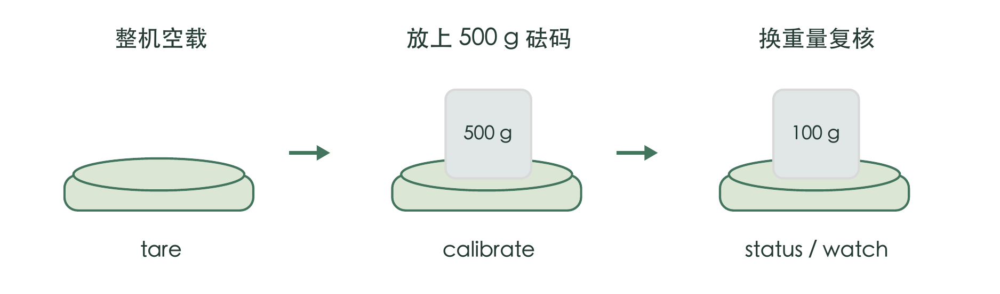

# 水伴杯垫工厂初始化说明

版本日期：2026年10月24日

## 工厂初始化与交付流程

每台杯垫在整机装配完成后，独立烧录、标定、复核并记录结果。通用固件可以共用，零点和重量比例必须按实物逐台生成。

**适用范围**：微雪 ESP32-S3-LCD-1.47B、TAL220B 2 kg 传感器、支持 3.3 V 的单 VCC HX711；固件 0.7.2。其他硬件版本应先核对引脚、供电与分区。



### 开工前准备

准备已装配完成的整机、可传数据的 Type-C 线、电脑、Arduino IDE、500 g 标定砝码，以及 100 g 和 1 kg 等复核砝码。记录砝码编号与质量依据，不用瓶装水标称容量代替已知质量。

| 检查项 | 要求 |
| --- | --- |
| 机械结构 | 螺丝、上盘、外壳处于最终装配状态；受力梁可正常形变；上盘不碰固定外壳，线缆不拉扯承重部分。 |
| HX711 接线 | VCC → 3V3；GND → GND；DOUT/DT → GPIO2；SCK/CLK → GPIO4。当前单 VCC 模块不接 5 V。 |
| 采样与量程 | HX711 A 通道，128 倍增益，10 SPS。2 kg 机械载荷包括上盘、杯子和水；去零不会增加机械量程。 |
| 操作台 | 平稳、坚硬、无碰触或明显振动。每次移放物品后松手并静置至少 3 秒。 |

生产放行前由负责人确定重量误差、重复性、偏载和回零限值，并填入第 4 页。当前项目没有已完成整机验证的精度承诺，不将软件测试结果当成出厂验收。

## 烧录与启动检查

先上传统一固件，再对该台整机进行标定。保留工程分区，禁止把其他设备含标定值、身份或凭证的整片 Flash 镜像复制过来。

Arduino IDE 打开 firmware/water_companion/water_companion.ino。复制工程时保留整个 water_companion 文件夹，尤其是同级 partitions.csv。

| Arduino 设置项 | 选择 |
| --- | --- |
| 开发板包 | esp32 by Espressif Systems 3.3.11 |
| Board | ESP32S3 Dev Module |
| USB Mode / USB CDC On Boot | Hardware CDC and JTAG / Enabled |
| Upload Mode / CPU Frequency | UART0 / Hardware CDC / 240MHz (WiFi) |
| Flash Mode / Flash Size | QIO 80MHz / 16MB (128Mb) |
| PSRAM | OPI PSRAM |
| Partition Scheme | 16M Flash (3MB APP/9.9MB FATFS)；实际使用工程 partitions.csv |
| Erase All Flash Before Sketch Upload | Disabled |
| Core Debug Level | None |

选择该台开发板对应串口，验证通过后上传。串口监视器选择 **115200** 和**新行 New Line**；重启后端口有变化时重新选择。

```json
{"cmd":"status"}
{"cmd":"watch","enabled":true}
```

确认固件版本为 0.7.2、启动日志到达 boot[ready]，raw 有连续读数且随加载改变。新机尚未标定时 weightGrams 为 null、calibrated 为 false，属于预期。

启动失败时发送 {"cmd":"diagnostics"} 并保存日志；先检查 PSRAM、分区及接线，不通过擦除 Flash 反复试错。

## 逐台执行重量标定

标定过程无需登录网站。以下命令逐条发送；每一步收到 ok 为 true 后再继续，若失败先排除原因。

### 1 整机空载归零

移走杯子、砝码和杂物，保留承重盘。松手并静置至少 3 秒。

```json
{"cmd":"tare"}
```

成功后零点已保存。未标定的新机会提示放上已知重量物品。不要把装着杯子的状态当成整机空载。

### 2 使用已知质量计算重量比例

将 500 g 砝码放在承重盘中央，松手并静置至少 3 秒。

```json
{"cmd":"calibrate","grams":500}
```

参数必须等于砝码实际已知质量。固件接受 50–2000 g，但加载时仍须计入上盘自重，不能超出传感器机械量程。

收到 ok 为 true 后，零点和 counts_per_gram 已保存到 settings 分区；无需另发保存命令。calibrate 会清除旧空杯设置，工厂最终交付时不预设用户空杯。

### 3 查看结果并准备复核

```json
{"cmd":"status"}
```

确认 calibrated 为 true，并观察 weightGrams。移走砝码，再换其他已知重量按第 4 页复核。

**不要用 stable 字段作为出厂标定门槛。**未设置用户空杯时它会保持 false，且可能提示“请先登记空杯重量”。标定命令另行检查原始采样稳定性，应以成功回执和重量复核结果判断。

换算关系为（原始读数 - 零点）÷ counts_per_gram。单点标定成功不代表全量程、重复性和偏载都已通过。现有 tare 只更新零点，保留原比例和空杯；更换传感器或改变承重结构后应重做完整标定与复核。

## 复核与逐台记录

以下记录留存到对应整机。没有约定限值或存在任一超限项目时，不填写合格，不用反复标定掩盖机械或电气问题。

工单／序列号：________________    操作员：____________
日期：________________    砝码编号：________________

已批准限值：重量误差 ±______ g；回零 ±______ g；
同一砝码重复取放极差 ≤______ g；偏载读数极差 ≤______ g。

| 复核项目 | 操作 | 实测与判定 |
| --- | --- | --- |
| 空载回零 | 移走砝码，静置后记录。 | ______ g<br>合格 / 不合格 |
| 100 g 复核 | 中央放置，记录读数减实际质量的误差。 | 读数 ______ g<br>误差 ______ g |
| 500 g 复核 | 重新取放标定砝码并记录。 | 读数 ______ g<br>误差 ______ g |
| 1 kg 复核 | 确认未超载，中央放置并记录。 | 读数 ______ g<br>误差 ______ g |
| 重复性 | 同一砝码中央重复取放 5 次；记录最大读数减最小读数。 | 最大 ______ g<br>最小 ______ g<br>极差 ______ g |
| 偏载 | 同一砝码放中心及承重区域四周，分别静置记录，不能悬空。 | 中心 ______ g<br>前后 ______ / ______<br>左右 ______ / ______ |
| 断电重启 | 完全断电再上电；确认 calibrated 为 true，再查空载和 500 g。 | 空载 ______ g<br>500 g ______ g |

复核期间可开启 watch 连续查看；结束后关闭。额外记录持续漂移、回零困难、碰外壳或线缆拉扯等异常。

```json
{"cmd":"watch","enabled":false}
```

最终判定：合格 / 不合格    复核人：____________
异常与处理：________________________________________________

## 联网测试与出厂交付

工厂完成重量标定；最终用户用自己的账号配网、绑定并设置空杯。设备编号和独立凭证由服务端首次注册时生成。

### 按出厂检验要求执行联网与记录测试

1. 使用测试账号打开 https://49.235.85.227/，按用户说明书完成蓝牙配网。测试网络应为普通 2.4 GHz Wi-Fi。
2. 确认页面完成绑定、设备云端在线。需要验证饮水记录时，登记测试空杯，加水放稳，再拿起、减少已知水量、放回，检查记录。
3. 测试完成，在“杯垫设置”中由原测试账号执行“解绑我的杯垫”并确认，保持设备联网直至同步完成。
4. 复查网页已解绑，设备 status 中 bound 为 false、emptyCupGrams 为 0、calibrated 为 true。重启复核；未同步完成时不要交付。

测试账号保留自己的测试历史。已登记的编号和凭证不应复制或删除；产线 Wi-Fi 可能继续保存，用户可长按配网键换成自己的网络。不要通过擦除 Flash 来“恢复出厂”，否则会丢失标定。

### 交付前逐项确认

□ 固件版本、启动与接线检查通过。
□ 零点和重量比例逐台保存，复核表完整且全部符合已批准限值。
□ 完全断电重启后标定和重量读数仍正常。
□ 测试账号已解绑，设备已同步，用户空杯未预设。
□ 产品随附用户说明书，网址和二维码对应当前正式服务。
□ 未把凭证、Wi-Fi 密码或蓝牙配对码打印进公开记录。

### 常见失败如何处理

| 提示或现象 | 处理 |
| --- | --- |
| 传感器未就绪 | 核对 3.3 V 供电、共地、GPIO2/4、桥路线序和连续采样，静置后重试。 |
| 零点或砝码采样不稳定 | 检查桌面振动、手部触碰、上盘碰壳、线缆拉力和砝码是否放稳。 |
| 配置写入失败 | 停止该台放行，保留设备数据及日志；检查 Flash 和分区配置。 |
| 只在某位置或某重量偏差大 | 检查受力与机械装配；修复后重新标定并完整复核，不能只看 500 g 点。 |

依据：firmware/README.md、docs/factory-provisioning.md、coaster.c 与 storage.c。配网、断电恢复和实际精度仍须按本说明逐台真机验收。
