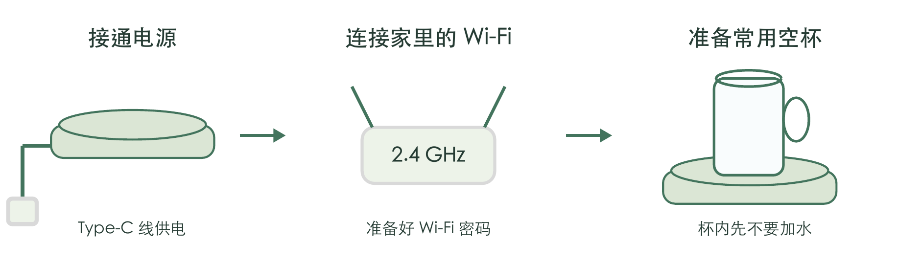
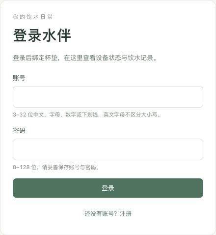
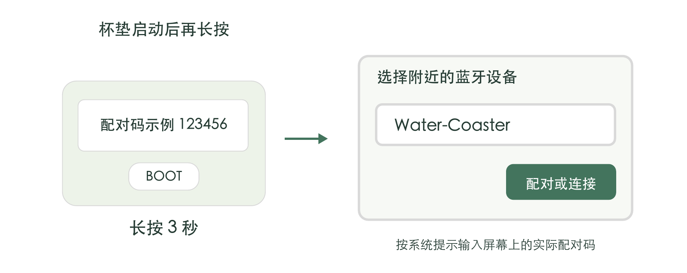
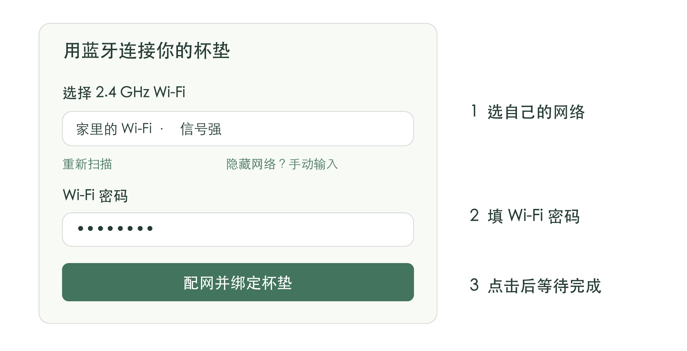
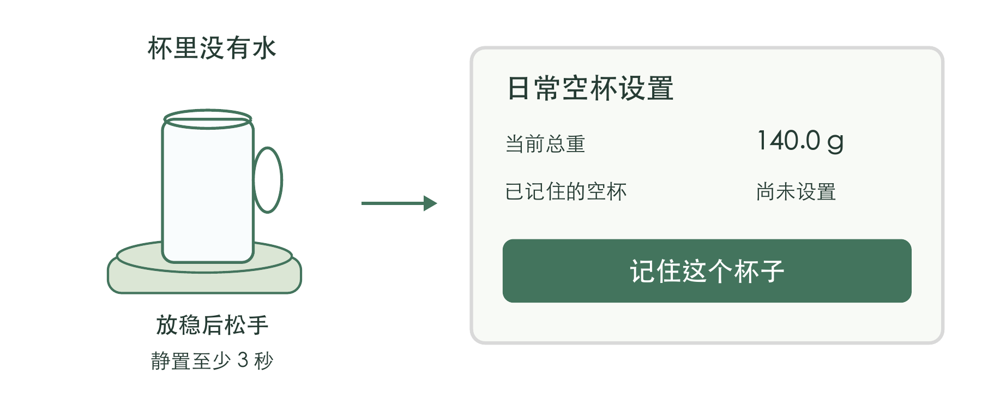
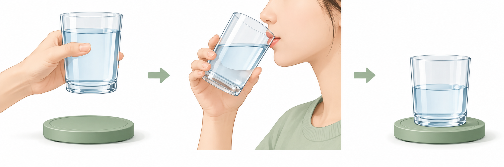

# 水伴杯垫用户使用说明书

版本日期：2026年10月24日

## 拿到杯垫后这样开始

先连接网络，再让杯垫记住你的空杯。以后每次拿起杯子喝水、放回杯垫，它会根据重量变化估算饮水量。

打开水伴使用页面

[https://49.235.85.227/](https://49.235.85.227/)

扫描右侧二维码，或在浏览器地址栏输入上方网址。请保留 https://。

### 首次连接用什么浏览器

建议使用**电脑上的 Chrome 或 Edge**，也可使用**安卓手机上的 Chrome**。打开蓝牙，并允许浏览器使用蓝牙。电脑本身也需要具备蓝牙功能。

iPhone 或 iPad 用户：先借助上述电脑或安卓手机，用**你自己的账号**完成首次连接。绑定成功后，可在 iPhone 的 Safari 中登录同一网址查看记录。

如果扫码后在微信等应用内打开，请复制网址到支持的浏览器。准备家中普通的 **2.4 GHz Wi-Fi** 及密码。

## 注册账号并连接杯垫

杯垫接通电源后，手机或电脑也要能正常上网。首次使用不需要填写设备编号，也不需要准备砝码。

### 1 注册或登录水伴

点击“还没有账号？注册”，设置自己的账号和密码，再点击“注册并登录”。

已有账号直接登录。请妥善保存账号和密码。

账号可使用中文、字母、数字或下划线；密码至少 8 位。

### 2 选择你的杯垫

登录后点击“添加杯垫”，再点击“选择杯垫”。在系统列表中选择 **Water-Coaster**。

找不到设备时，等杯垫启动完成，再长按 **BOOT 配网键 3 秒**。配网窗口持续约 10 分钟；不要按住 BOOT 再接通电源，也不用先去系统蓝牙列表配对。屏幕默认熄灭，需要查看配对码时短按侧边 BOOT 键，点亮 15 秒后自动熄屏。

## 选择家里的 Wi-Fi

蓝牙用来把网络信息交给杯垫。之后杯垫会自己连接 Wi-Fi，日常不需要一直连着手机蓝牙。

### 3 选择网络并输入密码

在“选择 2.4 GHz Wi-Fi”中选自己的网络，填写 Wi-Fi 密码，再点击**“配网并绑定杯垫”**。这里填写的是路由器密码，不是水伴账号密码。

没有找到网络时，先把杯垫放近路由器，再点“重新扫描”。确认路由器已开启 2.4 GHz；隐藏网络可点击“隐藏网络？手动输入”。

### 4 等待页面确认完成

看到**“杯垫已联网并完成绑定”**后，再进行下一步。过程中保持杯垫供电、手机或电脑联网。

若提示超时或蓝牙断开，先点**“继续查询配网结果”**。只有“蓝牙已连接”或“正在连接 Wi-Fi”，还不算完成。

需要网页认证的酒店网络、企业认证网络暂不支持。一个账号同时绑定一台杯垫。

## 让杯垫记住你的空杯

这一步告诉杯垫“杯子本身有多重”。首次使用、换杯子，或改变杯盖和吸管等配置时，重新做一次即可。

### 5 放好空杯后点击记住这个杯子

把常用杯子里的水倒空。平时一起放在杯垫上的杯盖、吸管等配件，也按日常状态放好。擦干杯底，再放到杯垫中央。

松手，静置至少 **3 秒**。在网站打开**“杯垫设置”**，找到“日常空杯设置”，点击**“记住这个杯子”**。首页出现“设置空杯”时，也可以从那里进入。

保持空杯不动，等到**“空杯设置成功，可以加水使用了。”**再拿起杯子加水。按钮显示“正在等待设置结果…”时，先继续等待或点击“查询设置结果”。

### 加水后先放稳一次

装好水，把杯子放回杯垫，松手并静置约 3 秒，再开始正常喝水。

**不要带着水设置空杯。**普通加水、喝水或重新通电后，不用每天重复设置。

## 每天喝水这样记录

保持杯垫供电，杯子放在承重区域中央。日常只需要正常拿起、喝水、放回。

| 拿起来 | 喝水 | 放回去 |
| --- | --- | --- |
| 杯底完全离开杯垫。 | 像平时一样喝水。 | 放回中央，松手，静置约 3 秒。 |

### 在网站查看饮水记录

登录同一个账号，查看“今日饮水量”“饮水次数”和“饮水记录”；切换“查看日期”可查看往日记录。误把倒掉的水记成饮水时，可在对应记录旁点击“撤销”。

### 这几种情况会影响记录

- 用吸管喝水但杯子一直没有拿起，可能不会生成饮水记录。很小的重量变化也可能不记。
- 喝完后先放回杯垫、等读数稳定，再拿去加水。喝水和加水连着做，只能看到最后的净变化。
- 倒水也会让重量变轻，杯垫无法分辨是喝掉还是倒掉。

清水约按 1 g 变化换算为 1 mL，属于估算。网页关闭后杯垫仍会工作；断网时先保存记录，恢复网络后再同步。断网期间尽量保持供电，避免部分记录的日期无法确认。

## 更换网络和常见问题

换路由器或 Wi-Fi 密码时，重新配网即可；使用同一个账号，不需要先解绑。

### 更换 Wi-Fi

1. 杯垫启动后，长按 BOOT 配网键 3 秒。
2. 在网站打开“杯垫设置”，找到“为我的杯垫更换 Wi-Fi”，点击“选择杯垫”。
3. 选择新网络，填写密码，点击“保存新的 Wi-Fi”，等页面确认成功。

| 遇到的情况 | 可以这样处理 |
| --- | --- |
| 搜索不到杯垫 | 打开蓝牙并允许浏览器使用；靠近杯垫；重新长按配网键。首次配网请使用第 1 页推荐的浏览器。 |
| 显示离线或未同步 | 检查供电及路由器网络；保持杯垫联网并稍候。换过 Wi-Fi 密码时，按上方步骤重新配网。 |
| 记住这个杯子无法点击 | 先等杯垫“云端在线”。提示尚未完成出厂标定时，联系购买渠道或售后，无需自行找砝码。 |
| 喝水后没有新记录 | 确认已设置空杯；杯子要完全拿起，放回后松手等稳定；同时检查杯垫是否在线。 |
| 屏幕不亮或自动变黑 | 屏幕默认熄灭，短按侧边 BOOT 键点亮，15 秒后自动熄屏；再次按下重新计时。拿放杯子和加水不会亮屏，熄屏时仍继续称重与上传。 |
| 提示已属于其他账号 | 请原主人登录，在“杯垫设置”中点击“解绑我的杯垫”并确认。新主人绑定后重新设置空杯。 |

日常保持杯垫和杯底干燥，用软布擦拭；不要浸水、冲洗、用手压住承重盘或放置重物。遇到异常，联系购买渠道并提供屏幕提示或页面截图。

浏览器说明参考：[Chrome 网页蓝牙说明](https://developer.chrome.com/docs/capabilities/bluetooth)、[Edge 网页蓝牙支持说明](https://learn.microsoft.com/en-us/deployedge/microsoft-edge-policies/DefaultWebBluetoothGuardSetting)。
