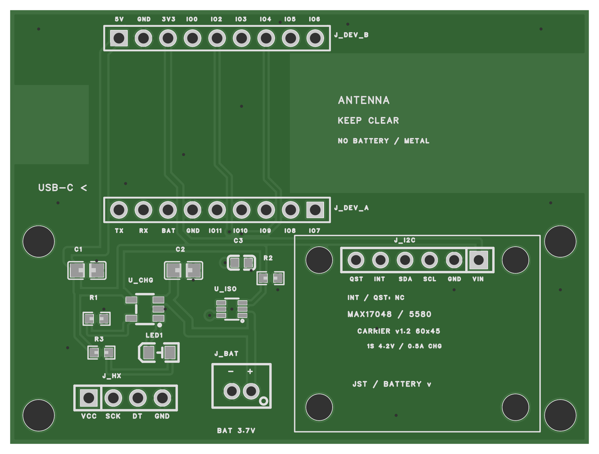

# 电池连接底板 v1.2：六针直插、同面安装与完整引脚丝印

更新：2026-10-24。当前修订为 **v1.2**：MAX17048 / Adafruit 5580 改为六针排母同面直插，INT、QST 留空；开发板 18 个引脚均增加丝印，并疏开元件布局。保留用户确认的 HX711 **VCC、SCK、DT、GND** 顺序。沿用 60 × 45 mm 双层板、Adafruit 5580 电量计接口、MCP73831 约 0.5 A 充电及 LM66100 隔离。尚未打样、装配或上电；本轮没有修改固件。

## 工程与生产文件

嘉立创 EDA 工程名为 **“杯垫电池底板 v1.1 MAX17048”**，板子名为 `carrier-v1.1`。旧 v1 工程保留用于对照。

| 文件 | 用途 |
| --- | --- |
| [carrier-v1.1.epro2](carrier-v1.1.epro2) | 完整可编辑原理图、PCB 和所需库 |
| [gerber.zip](gerber.zip) | 交给 PCB 厂的双层板制造文件 |
| [bom.csv](bom.csv) | 底板 14 个元件、13 个条目；UTF-8，不含外接模块和线材 |
| [placement.csv](placement.csv) | 元件坐标；贴片前按封装 Pin 1 核对角度 |
| [原理图 PDF](schematic.pdf) | 1 页；保留中文的图像版，编辑请用工程文件 |
| [PCB PDF](pcb-review.pdf) | 顶面与接口、BOM、顶层铜、镜像底层铜、钻孔图，共 5 页；由最终 Gerber / Excellon 生成，不是 1:1 模板 |
| [checks.json](checks.json) | DRC、ERC、网表、钻孔及导出核对记录 |
| [原理图网表](schematic-netlist.json)、[PCB 网表](pcb-netlist.json) | 原生导出，供后续修改核对 |

[底层预览](pcb-bottom.png)为从底面观察的镜像图；另有[原理图 PNG](schematic.png)及 [SVG](schematic.svg)。

## HX711 修正与全部元件引脚复核

用户于 2026-10-24 确认，手上 HX711 **从 VCC 一端沿排针依次为 VCC、SCK、DT、GND**。本版已把 J_HX-2 从 GND 改为 HX_SCK、J_HX-4 从 HX_SCK 改为 GND，同时重做相关走线、双面铺铜和丝印。GPIO 分配不变：DT=GPIO2、SCK=GPIO4。

**从底板顶面看，开发板 LCD 朝上、Type-C 朝左时，J_HX 从左到右：**

| 底板 J_HX | 模块引脚 | 底板网络及去向 |
| --- | --- | --- |
| 1（方焊盘） | VCC | 3V3 → J_DEV_B-3 |
| 2 | SCK | HX_SCK → J_DEV_B-7 → GPIO4 |
| 3 | DT | HX_DT → J_DEV_B-5 → GPIO2 |
| 4 | GND | 共地 |

**此前 v1 / v1.1 的制造文件采用 VCC、GND、DT、SCK，与这块模块不一致。请替换已下载的旧工程、Gerber 和图纸；已有旧板须按信号名称逐根转接，不能直接插接这块 HX711。** 本版保留 `carrier-v1.1` 路径和文件名以兼容既有链接，以 PCB 丝印、原理图版本栏及 `checks.json` 中的 **v1.2** 区分。v1.1a 的 HX711 针序已修正，但 MAX17048 仍为四针转接接口；本版六针布局需使用本版全部生产文件。

本次按指定型号的数据手册／官方板图检查了符号脚号、封装焊盘、顶视方向及实际网络，再比较原理图、PCB 和 Gerber 内的飞针网表。除 HX711 外，未发现新的引脚映射错误；不能据此认定用户手中所有模块和线束都已通过实物验证。

| 位号（共 14 个元件） | 引脚与网络核对结果 |
| --- | --- |
| U_CHG / MCP73831T-2ACI/OT | 1 STAT=CHG_STAT；2 VSS=GND；3 VBAT=BAT_CELL；4 VDD=USB_5V；5 PROG。SOT-23-5 焊盘与手册匹配，Pin 1 对应本板右下丝印圆点。 |
| U_ISO / LM66100DCKR | 1 VIN=BAT_CELL；2 GND；3 CE=USB_5V；4 NC；5 ST=GND；6 VOUT=BAT_DEV。手册允许不用 ST 时接地；SC70-6 焊盘与手册匹配，Pin 1 对应本板右下丝印圆点。 |
| LED1 / 17-21SURC/S530-A2/TR8 | 左焊盘 1=阴极 K/CHG_STAT；右焊盘 2=阳极 A/LED_A。极性正确，焊盘尺寸差异仍需贴片厂确认，见下文。 |
| J_DEV_A | 6=GND、7=BAT_DEV；1–5、8、9 为 NC。对应微雪 U2-1…9；从底板顶面左到右为 U2-9…1。 |
| J_DEV_B | 1=USB_5V、2=GND、3=3V3、4=NC、5=HX_DT/GPIO2、6=NC、7=HX_SCK/GPIO4、8=FG_SDA/GPIO5、9=FG_SCL/GPIO6。顶面左到右对应微雪 U2-10…18。 |
| J_HX | 1=3V3、2=HX_SCK、3=HX_DT、4=GND；按本次用户确认修正。 |
| J_I2C | 1 VIN=3V3、2 GND、3 SCL=FG_SCL/GPIO6、4 SDA=FG_SDA/GPIO5、5 INT=NC、6 QST=NC；与模块相同脚号直接插接。 |
| J_BAT | 1=BAT_CELL（本板顶面右焊盘）、2=GND（左焊盘），与丝印 +/− 一致；5580 的电池口编号为 2=VBAT、1=GND，线束须实测极性。 |
| R1 / 2 kΩ | 1=PROG、2=GND；电阻无极性。 |
| R2 / 100 kΩ | 1=USB_5V/CE、2=GND；电阻无极性。 |
| R3 / 2.2 kΩ | 1=USB_5V、2=LED_A；电阻无极性。 |
| C1 / 10 µF | 1=USB_5V、2=GND；BOM 指定陶瓷电容，无极性。 |
| C2 / 10 µF | 1=BAT_CELL、2=GND；BOM 指定陶瓷电容，无极性。 |
| C3 / 1 µF | 1=BAT_DEV、2=GND；BOM 指定陶瓷电容，无极性。 |

U_CHG、U_ISO 的引脚按[Microchip 手册](https://ww1.microchip.com/downloads/en/DeviceDoc/MCP73831-Family-Data-Sheet-DS20001984H.pdf)与[TI 手册](https://www.ti.com/lit/ds/symlink/lm66100.pdf)核对；开发板使用[微雪官方原理图](https://files.waveshare.com/wiki/ESP32-S3-LCD-1.47B/ESP32-S3-LCD-1.47B_schematic_diagram.pdf)和[背面针脚照片](https://docs.waveshare.com/assets/images/ESP32-S3-LCD-1.47B-details-inter-610934cad708d11776afc4d86d8ae498.webp)交叉核对，避免将背视图直接当顶视图。5580 的排针和两个电池口按 [Adafruit 官方 PCB](https://github.com/adafruit/Adafruit-MAX17048-PCB/blob/main/Adafruit-MAX17048-STEMMA.brd)核对。

开发板实物 R30/R31 配置、电池线束极性、HX711 传感器端接线以及装配后的通断仍须实测；本次用户仅确认了 HX711 的四针电源／数字接口顺序，未据通用模块照片推断其余实物端子。

## 六针接口与同面直插

底板 `J_I2C` 使用 **1×6、2.54 mm、立创 C40877 排母**；模块焊接配套公排针，长针朝下插入底板。开发板、MAX17048 模块和全部底板元件均朝顶面安装。

从 **VIN / 方焊盘** 一端开始，顺序与模块一致：

| 底板 J_I2C | 模块引脚 | 底板连接 |
| --- | --- | --- |
| 1（方焊盘） | VIN | 3V3 → J_DEV_B-3 |
| 2 | GND | 共地 |
| 3 | SCL | FG_SCL → J_DEV_B-9 → GPIO6 |
| 4 | SDA | FG_SDA → J_DEV_B-8 → GPIO5 |
| 5 | INT | NC，底板不接线 |
| 6 | QST | NC，底板不接线；保留模块已有下拉 |

**按顶面图观察，LCD 朝上、Type-C 朝左时，六针从左到右显示 QST、INT、SDA、SCL、GND、VIN，Pin 1 在右侧。** 这是模块电池插座朝下边缘时的安装方向；模块与底板的 VIN 方焊盘须对齐。六针一一插接，SDA / SCL 无需交叉杜邦线。INT、QST 的孔保留作机械插接，原理图已标 NC，PCB 无走线。

VIN 接开发板 **3.3 V**，用于模块接口电路和 I²C 上拉；不能接电池正极或 5 V。模块已有 I²C 上拉，底板没有重复增加上拉电阻。模块上的 STEMMA QT 是 JST-SH 1.0 mm 四针口，本方案使用六针排针。

## ESP32-S3 开发板引脚标注

使用微雪 **ESP32-S3-LCD-1.47B**。以下均从底板顶面看，LCD 朝上、Type-C 朝左；`IO` 表示 GPIO。

| 排针 | 顶面从左到右的丝印 |
| --- | --- |
| 上排 J_DEV_B，本地 1 → 9 | 5V、GND、3V3、IO0、IO2、IO3、IO4、IO5、IO6 |
| 下排 J_DEV_A，本地 9 → 1 | TX、RX、BAT、GND、IO11、IO10、IO9、IO8、IO7 |

未接入底板电路的 GPIO 仍标出其开发板功能；其焊盘在底板保持 NC。5V 为开发板的 USB VBUS，BAT 为隔离后的 BAT_DEV，不能与 J_BAT 的 BAT_CELL 短接。

## 电池怎么接

电池连接路径：**带保护板的单节电池 → 5580 任一电池插座 → 5580 另一电池插座 → 底板 J_BAT**。5580 的两个电池口内部并联，电量计检测的是真实 `BAT_CELL`；5580 不负责充电，充电仍由底板完成。

电池与 5580 之间使用电池原有插头；5580 与底板之间增加一根两端均能插入对应板载插座的 **JST-PH 2.0 mm / 2P 线束**。先断开 USB 和电池，用万用表核对：

- 底板 J_BAT-1 是 BAT+，J_BAT-2 是 GND；5580 官方板的 JST 焊盘编号为 **2=VBAT、1=GND**。按实际正负极接通，不能套用“1 对 1”或只按商家“同向／反向”命名购买。
- 电池正极必须一路通到 5580 的 VBAT 及底板 BAT_CELL；负极一路通到 GND。插头外壳能插入不代表极性正确。
- 开发板原有电池插座留空。不要另接电池到开发板 BAT 引脚，否则会绕过底板充电隔离。

继续使用用户确认的 **603759、3.7 V、1500 mAh、带保护板**电池，满充 4.2 V，正常充放电按不超过 0.75 A 约束。底板 `U_CHG=MCP73831T-2ACI/OT`、`R1=2.00 kΩ`，标称充电电流约 0.5 A；不要替换成其他充电电压版本。Type-C 仍接开发板，实际充电指示看底板 LED1。

`BAT_CELL` 与 `BAT_DEV` 仍分开，LM66100 的 VIN 接电池、VOUT 接开发板 BAT、CE 接 USB_5V。开发板须保持 **R30=0Ω、R31 不装**，确保 J_DEV_B-1 取到 USB VBUS。完整充电与隔离说明见本文附录。

## 模块安装

5580 安装在**底板顶面，模块器件朝上**，与开发板和贴片元件同面。模块两个电池插座朝底板下边缘，六针排母位于模块上边缘；四个 M2 安装孔位置与官方模块一致。

底板排母 C40877 的塑高为 8.5 mm。模块公排针焊好、完全插合后，按实际两板间距选配四根 **M2 尼龙隔离柱及螺丝**；常见公排针组合的间距约 11 mm，但应以实物测量为准，不能强行使用旧方案的 6 mm 隔离柱。支柱只固定模块，不能靠螺丝把排针拉弯或顶起。螺钉头、插头拔插及外壳高度仍须试装确认。

J_BAT 移至 (24.00,5.50)，J_HX 移至 (12.00,4.80)，模块外形投影内仅放六针排母；其余元件在模块左侧或上方。充电／隔离芯片周围电阻、电容和 LED 重新疏开。按本版保守平面包络计算，最邻近 C3 / R2 间距约 1.03 mm，模块投影与其他元件最小约 1.34 mm；这只验证平面排布，不代替实物装配。

以下坐标从底板顶层看，原点为左下角，单位 mm；底层预览图会左右镜像：

| 项目 | 尺寸或坐标 |
| --- | --- |
| 底板 | 60 × 45，双层；建议样机 FR-4、1.6 mm、1 oz，订单另行设置 |
| 5580 外形投影 | x=29.50…54.90，y=1.30…21.62；25.40 × 20.32 |
| 新增模块孔 | 4 个 Ø2.7 NPTH；(32.04,3.84)、(52.36,3.84)、(32.04,19.08)、(52.36,19.08) |
| 模块孔距 | 20.32 × 15.24；5580 自身孔径约 2.5 mm，使用 M2 紧固件 |
| 原底板安装孔 | 4 个 Ø3.2 NPTH；(3,3)、(57,3)、(3,21)、(57,21)，保持不变 |
| J_I2C 六针排母中心 | (42.20,19.08)，针距 2.54，顶面旋转 180°，Pin 1 在右 |
| J_I2C 各针中心 | y 均为 19.08；1…6 的 x 为 48.55、46.01、43.47、40.93、38.39、35.85 |
| 双面天线净空 | x=29…60，y=26…40.5，保持不变 |
| 双面 USB 净空 | x=0…8.2，y=29…37.2，保持不变 |

安装孔及投影依据 Adafruit 官方 PCB 文件。模块线束从下方走，避开天线区；电池、模块和线束不分担传感器载荷。HX711 按本页已确认的针序连接；开发板两排排母按上述顶面方向核对。

## 相对 v1 需要增加的物料

| 物料 | 数量 | 说明 |
| --- | ---: | --- |
| Adafruit MAX17048 模块，产品 5580 | 1 块 | 成品板，不是裸 MAX17048 芯片 |
| 底板 J_I2C，1×6 / 2.54 mm 排母 | 1 个 | 立创 C40877，塑高 8.5 mm，已计入底板 BOM |
| 模块 1×6 / 2.54 mm 公排针 | 1 条 | 若套装已附带则无需另买；需要焊接 |
| PH 2.0 mm / 2P 双端线束 | 1 根 | 接模块与底板；按实际正负极配线并测量确认 |
| M2 尼龙隔离柱及匹配螺丝 | 4 套 | 按排针完全插合后的板间距配高（通常约 11 mm）；不要用 M3 强穿模块孔 |

其余元件沿用原底板 BOM。外接模块、线束、紧固件不在贴片 BOM 内；未核实实时库存、价格，也未下单。

## 检查结果与后续上电

- 最终 PCB 严格 DRC 返回 `[]`，原理图与 PCB 的 14 个元件、43 个已连接引脚逐脚一致；另有 12 个 NC（含新增 INT、QST）。Gerber 飞针网表的 43 个已连接引脚也逐脚一致；全部 55 个元件焊盘坐标均与工程一致，12 个 NC 在飞针文件中各自独立。六针焊盘与安装孔已逐个对照官方 Eagle PCB 坐标。
- 本版原理图 API 返回 1 项警告、没有错误项；v1.1a 已在面板确认库属性警告及 7 项描述性位号提示，本版未逐条复核警告明细，不标为 ERC 零警告。
- 其中电阻、电容、连接器的物料编号与封装匹配，差异为用途名称、单位或额定值备注。LED1 的 C131244 与制造商型号一致，但工程封装名 `LED0805-RD` 与库推荐的 `LED0805-R-RD-1` 不同，制造商名称也有文字差异。现有焊盘约 1.00 × 1.25 mm、中心距 2.20 mm；[Everlight 数据手册第 2 页](https://media.distrelec.com/Web/Downloads/_t/ds/17-21SURC_S530-A2_eng_tds.pdf)建议焊盘 1.20 × 1.20 mm、中心距 2.10 mm。已核对 Pin 1 阴极接 CHG_STAT、Pin 2 阳极接 LED_A，保留原 v1 封装；若委托贴片，须让厂家确认该焊盘差异和装配方向。
- 已核对板框、4 个模块孔、原安装孔、两面铺铜和天线／USB 净空。修订后为 100 段走线、25 个过孔；导出工程与已检查源数据一致，最终图纸逐页检查、压缩包完整性通过。
- 尚未进行厂商 DFM、实物配合、焊接、供电、充放电、温升或 I²C 通信测试。

首次上电前，先断电检查电池线束极性、两排开发板插接方向和 R30/R31 配置；用限流电源检查供电和隔离，再装电池测试 USB 插拔、充电电流、终止和温升。原开发板 BAT_ADC 位于隔离后的 BAT_DEV，USB 接入时不能用它代替电量计判断真实电池状态。

后续固件应使用 **GPIO5=SDA、GPIO6=SCL、地址 0x36** 读取 MAX17048，可从 100 kHz I²C 开始调试。本次只完成硬件接口与交付文件，尚未增加驱动或屏幕电量显示。MAX17048 提供电压与估算剩余百分比，不直接测出电池老化后的真实可用 mAh。

## 官方资料

- [Adafruit 5580 产品](https://www.adafruit.com/product/5580)
- [模块引脚与电池口说明](https://learn.adafruit.com/adafruit-max17048-lipoly-liion-fuel-gauge-and-battery-monitor/pinouts)
- [Adafruit PCB 原始文件](https://github.com/adafruit/Adafruit-MAX17048-PCB)
- [Adafruit Arduino 接入说明](https://learn.adafruit.com/adafruit-max17048-lipoly-liion-fuel-gauge-and-battery-monitor/arduino)
- [微雪开发板官方原理图](https://files.waveshare.com/wiki/ESP32-S3-LCD-1.47B/ESP32-S3-LCD-1.47B_schematic_diagram.pdf)

## 附录：沿用的充电与隔离设计

### 充电隔离

微雪官方原理图为 `U1 = ETA6098`、`R5 = 82 kΩ`。ETA6098 数据表第 2 页对应典型充电电流约 2 A，超过这块电池给出的 0.75 A。只并联一个 0.5 A 充电器不能限制原有 2 A 充电器。

因此 `BAT_CELL` 与 `BAT_DEV` 分开，由 LM66100 在 USB 存在时关闭两者之间的 MOSFET，阻止原充电器给电池充电。接线方向为 **VIN 接电池，VOUT 接开发板 BAT**。

LM66100 的 CE 是与 VIN 比较的模拟使能端：`CE > VIN + 80 mV` 时保证关闭，`CE < VIN − 250 mV` 时保证开启。本设计将 CE 接 USB 5 V；当 ETA6098 达到其输入工作条件时，CE 已高于电池电压而关闭隔离器件。拔掉 USB 后，R2 把 CE 拉低以启用电池供电。

**CE 不能接地或悬空。** 接地会让 USB 充电时的 MOSFET 仍保持开启，破坏这里的隔离。本设计也不采用 CE 接 VOUT 后等到出现反向电流才触发的连接方式。

LM66100 内部保留从 VIN 到 VOUT 的体二极管，关闭时仍可能向开发板方向正向导通；它在此处的作用是阻断开发板到电池的反向充电，不是双向断电开关。USB 插拔瞬间的反向电流、时序和电压波形仍须测量，不能把稳态分析当作瞬态验证。

### 充电设定与指示

MCP73831 数据表的公式为 `IREG(mA) = 1000 / RPROG(kΩ)`。R1 取 2.00 kΩ，标称为 500 mA。数据表给出该阻值的充电电流范围为 450–550 mA（规定测试温度下，设计保证而非逐颗测试）；计入 1% 电阻误差估算上界约 556 mA，仍低于 750 mA。这个计算不代替样机测量和完整温度条件下的验证。

充电芯片选用 **4.2 V 的 `-2` 版本**，不能换成 4.35 V / 4.4 V / 4.5 V 版本。输入和电池侧电容在工作偏压下需保持至少 4.7 µF 有效容量。

LED1 从 USB_5V 经 R3 接到 STAT，用于显示底板实际充电状态。亮表示底板正在充电；灭也可能是未接 USB 或没有电池，不能单凭熄灭判定充满。开发板原充电灯和原 BAT_ADC 测的是隔离后的 BAT_DEV，USB 连接时不能用它们判断本电池的充电状态或电量。

MCP73831 是线性充电芯片；散热不足时会降低充电电流。以 5 V 输入、电池 3.0 V、0.5 A 估算，芯片耗散约 1 W，SOT-23-5 封装可能进入热调节。布板需给散热留铜面积并实测温升，不承诺全程维持 0.5 A，也不据此承诺充满时间。

