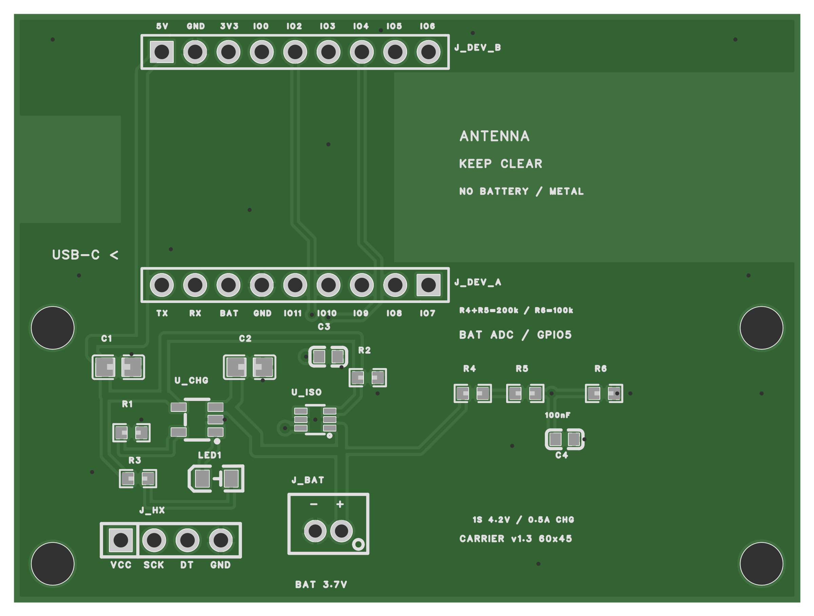

# 电池连接底板 v1.3：ADC 电量采样

更新：2026-10-24。本版以 **3 颗 100 kΩ 电阻和 1 颗 100 nF 电容**替代 Adafruit 5580 / MAX17048 模块，供后续固件显示几格电量和低电提醒。原理图、PCB、制造文件与预览已更新；尚未打样或上电，电量显示固件尚未实现。

新工程独立保存为 **“杯垫电池底板 v1.3 ADC”**，板子与原理图为 `carrier-v1.3`，PCB 为 `carrier-v1.3-pcb`。此前 v1.2 工程及文件保留；生产时使用本目录整套 v1.3 文件。

## 交付文件

| 文件 | 用途 |
| --- | --- |
| [carrier-v1.3.epro2](carrier-v1.3.epro2) | 可导入嘉立创 EDA 专业版的完整工程，含原理图、PCB 与所需库 |
| [gerber.zip](gerber.zip) | 双层 PCB 制造文件，含铜层、阻焊、钢网、丝印、板框、钻孔与飞针数据 |
| [bom.csv](bom.csv) | 17 个元件、13 个物料条目，UTF-8 逗号分隔 |
| [placement.csv](placement.csv) | 17 个元件的顶面贴装坐标，单位 mm；按 Pin 1 核对角度 |
| [原理图 PDF](schematic.pdf) | 1 页；图像版保留中文，可编辑版本见工程及 SVG |
| [PCB 核对 PDF](pcb-review.pdf) | 5 页：顶面、BOM、顶层铜、镜像底层铜、钻孔；不是 1:1 装配模板 |
| [checks.json](checks.json) | DRC、ERC、网表、导出一致性、钻孔与文件校验记录 |
| [原理图网表](schematic-netlist.json)、[PCB 网表](pcb-netlist.json) | 原生网表，供后续修改核对 |



另有[底面预览](pcb-bottom.png)、[原理图 PNG](schematic.png)和[原理图 SVG](schematic.svg)。底面预览左右镜像；坐标表均从顶面观察。

## 本次修改

- 移除 J_I2C 六针排母、5580 安装投影、四个模块安装孔及对应走线、丝印。
- 新增 R4、R5、R6、C4；R4 与 R5 串联组成 200 kΩ 上臂，R6 为 100 kΩ 下臂。
- 采样点 `BAT_SENSE` 接 J_DEV_B-8 / GPIO5；GPIO6 即 J_DEV_B-9 改为 NC。
- 电池直接接底板 J_BAT，采样源为隔离前的 `BAT_CELL`。
- 保持 60 × 45 mm 双层板、原四个固定孔、两排开发板插座及 HX711 接口位置。原充电、隔离电路和 HX711 的 VCC/SCK/DT/GND 针序保留。

## 新增物料

| 位号 | 数量 | 规格 | 嘉立创商城编号 |
| --- | ---: | --- | --- |
| R4、R5、R6 | 3 | 100 kΩ，±1%，0603，UNI-ROYAL 0603WAF1003T5E | [C25803](https://www.lcsc.com/product-detail/C25803.html) |
| C4 | 1 | 100 nF / 0.1 µF，50 V，X7R，0603，YAGEO CC0603KRX7R9BB104 | [C14663](https://www.lcsc.com/product-detail/C14663.html) |

**R4、R5 是两颗独立 100 kΩ 串联，不需要再买 200 kΩ 电阻。** 原有 R2 也是 C25803，但它用于充电隔离使能下拉，必须保留；整板共用 4 颗 100 kΩ，其中新增 3 颗。0603 电阻、电容均无极性。

5580 模块及其六针排母、模块排针、四套支柱和模块转接线不再需要。继续复用现有开发板、HX711、传感器和带保护板的电池。BOM 中两个自建 IC 的商城编号为空，采购按完整型号 `MCP73831T-2ACI/OT`、`LM66100DCKR`，本次没有另选替代型号或下单。

## 采样连接与固件约定

```text
BAT_CELL ─ R4 100k ─ R5 100k ─┬─ BAT_SENSE → J_DEV_B-8 → GPIO5
                            ├─ R6 100k ─ GND
                            └─ C4 100nF ─ GND
```

名义分压比为 `100k / (100k + 100k + 100k) = 1/3`。满充 4.2 V 时，ADC 输入约 1.4 V；固件以校准后的 ADC 电压乘 3 换算电池电压。电阻误差、ADC 误差和负载压降需要样机校准。

GPIO5 对应 ESP32-S3 的 ADC1_CH4；可从 6 dB 衰减配置开始验证，其官方标称量程覆盖 1.4 V。设置为模拟输入，关闭上下拉，不能继续作为 I²C SDA 或输出使用。100 nF 用于滤波；等效源电阻约 66.7 kΩ，时间常数约 6.7 ms，上电或重新接入采样后预留约 35–50 ms，再低频采样、多次平均。依据：[Espressif ADC 说明](https://docs.espressif.com/projects/esp-idf/en/v4.4.7/esp32s3/api-reference/peripherals/adc.html)、[ESP32-S3 数据手册](https://www.espressif.com/sites/default/files/documentation/esp32-s3_datasheet_en.pdf)。

分压支路持续接在电池上，4.2 V 时约耗电 14 µA（约 0.34 mAh/天），本版未增加采样开关。这只是分压支路的功耗，不代表整机待机功耗。

此方案适合粗略电量格数和低电提醒。电池电压受充电、负载和温度影响，固件需使用平滑与回差，并在实际电池上确认阈值；不能把电压直接当作精确剩余百分比。开发板原 GPIO1/BAT_ADC 位于隔离后的 `BAT_DEV`，USB 接入时不能代替这条真实电池采样线路。本轮未修改固件。

## 电池、开发板和 HX711 接线

电池直接插入底板 **J_BAT**。从本目录顶面图看，右焊盘 1 为 `BAT_CELL / +`，左焊盘 2 为 `GND / −`。先实测电池插头极性，外壳能插入不代表极性一致。开发板原电池插座留空，`BAT_CELL` 与 `BAT_DEV` 不可短接。

继续使用既定的 603759、3.7 V、1500 mAh、带保护板电池，满充 4.2 V；原方案按正常充放电不超过 0.75 A 约束。USB Type-C 接开发板。开发板应保持 **R30=0Ω、R31 不装**，J_DEV_B-1 才是本设计所需的 USB VBUS。

| 接口 | 连接 |
| --- | --- |
| J_HX，顶面从左到右 1…4 | VCC/3V3、SCK/GPIO4、DT/GPIO2、GND |
| J_DEV_A | 6=GND、7=BAT_DEV；其余 NC |
| J_DEV_B | 1=USB_5V、2=GND、3=3V3、5=HX_DT、7=HX_SCK、8=BAT_SENSE；4、6、9 为 NC |

LCD 朝上、USB 朝左时，两排开发板丝印：上排从左到右为 5V、GND、3V3、IO0、IO2、IO3、IO4、IO5、IO6；下排为 TX、RX、BAT、GND、IO11、IO10、IO9、IO8、IO7。未接入底板的 GPIO 仍标出开发板功能，底板焊盘保持 NC。

## 机械与制造

| 项目 | 数值或位置（顶视，左下原点，mm） |
| --- | --- |
| 板框 | 60 × 45，双层；样机可沿用 FR-4、1.6 mm、1 oz，订单参数另设 |
| 底板安装孔 | 4 × Ø3.2 NPTH：(3,3)、(57,3)、(3,21)、(57,21) |
| J_BAT / J_HX 中心 | (24,5.5) / (12,4.8) |
| 新增 R4 / R5 / R6 中心 | (35,16) / (39,16) / (45,16) |
| 新增 C4 中心 | (42,12.5) |
| 双面天线净空 | x=29…60，y=26…40.5 |
| 双面 USB 净空 | x=0…8.2，y=29…37.2 |

全部 17 个底板元件在顶面。电池、金属、线束避开天线净空；底板、线束不能分担传感器载荷。四个 5580 模块孔已移除，不再安装模块支柱。排针插合高度、插头空间与外壳配合仍需实物试装。

## 检查结果及未验证项

- 最终 PCB 严格 DRC 返回 `[]`。原理图与 PCB 的 17 个元件、46 个已连接引脚和 11 个 NC 一致；Gerber 飞针数据的全部 57 个元件焊盘坐标与工程一致。导出器把仅连接 R4-2 / R5-1 的 `BAT_DIV_MID` 命名为 `NET_11`，已按连接集合核对，详见检查记录。
- 板框、4 个固定孔、24 个连接器通孔、28 个过孔、99 段走线、两面铺铜及天线/USB 净空通过检查。新增 4 个元件的 8 个焊盘均有钢网开口。`Drill_PTH_Through_Via.DRL` 是总 PTH 文件的过孔子集，不能重复叠加钻孔。
- 原生工程导出与已检查的原理图、PCB 数据一致；BOM、贴装坐标及压缩包核对通过。PDF 六页均已渲染检查。
- 原理图 ERC 为 0 致命错误、0 错误，保留 1 项“元件属性与供应商编号不匹配”提示，涉及继承的连接器、阻容、LED 属性；另有 6 个描述性位号的信息提示。新增电阻复用原 R2 的器件库；C4 使用对应 C14663 器件库。不宣称 ERC 零警告。
- LED1 沿用既有 `LED0805-RD` 封装：左 1 为阴极，右 2 为阳极；焊盘约 1.00 × 1.25 mm、中心距 2.20 mm，与此前记录的厂家建议 1.20 × 1.20 mm、中心距 2.10 mm 有差异。委托贴片前须由厂商 DFM 确认此差异及方向。
- 尚未进行厂商 DFM、实物装配、上电、充放电、USB 插拔瞬态、温升、ADC 校准及电量显示验收。静态检查不代表已通过这些测试。

首次测试先断电核对极性、插接方向与开发板 R30/R31，再用限流电源检查供电和隔离。接入电池后，用万用表同时测 `BAT_CELL` 与 `BAT_SENSE`，验证约 3:1；分别在电池供电、USB 充电以及屏幕/无线负载变化时采样，确认充电电流、终止、温升及显示阈值。

## 沿用的充电与隔离

MCP73831T-2ACI/OT 为 4.2 V 版本，R1=2 kΩ 对应标称约 0.5 A 充电；不能换成不同终止电压版本。LM66100 的 VIN 接电池、VOUT 接开发板 BAT，CE 接 USB_5V，R2 在拔掉 USB 后拉低 CE。本版保留该电路及原有元件位置。

USB 存在时，LM66100 用于阻断开发板原充电器向电池反向充电；它保留从电池到开发板方向的体二极管，不是双向断电开关。底板 LED1 指示本充电器状态，灯灭也可能是未接 USB 或无电池，不能单凭熄灭判定充满。开发板原充电灯不用于判断本电池状态。

MCP73831 为线性充电器，5 V 输入、电池 3.0 V、0.5 A 时功耗估算约 1 W，可能进入热调节，不能承诺全程维持 0.5 A。充电电流、有效电容容量、终止与热性能按原设计要求实测。参考：[Microchip 手册](https://ww1.microchip.com/downloads/en/DeviceDoc/MCP73831-Family-Data-Sheet-DS20001984H.pdf)、[TI LM66100 手册](https://www.ti.com/lit/ds/symlink/lm66100.pdf)、[微雪开发板原理图](https://files.waveshare.com/wiki/ESP32-S3-LCD-1.47B/ESP32-S3-LCD-1.47B_schematic_diagram.pdf)。
