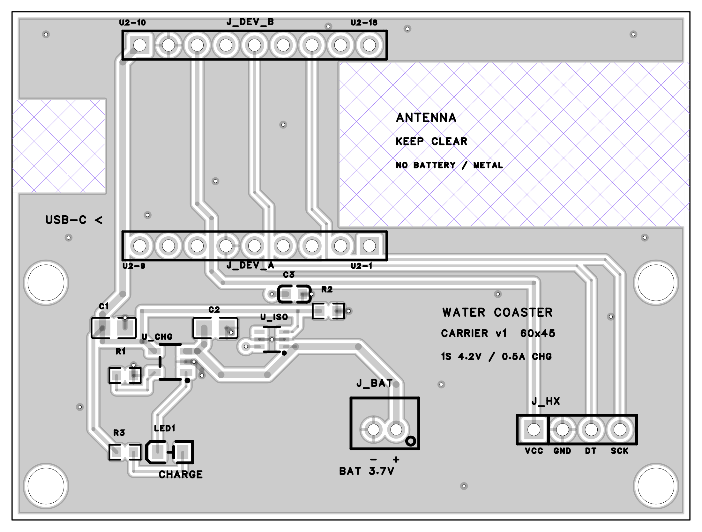
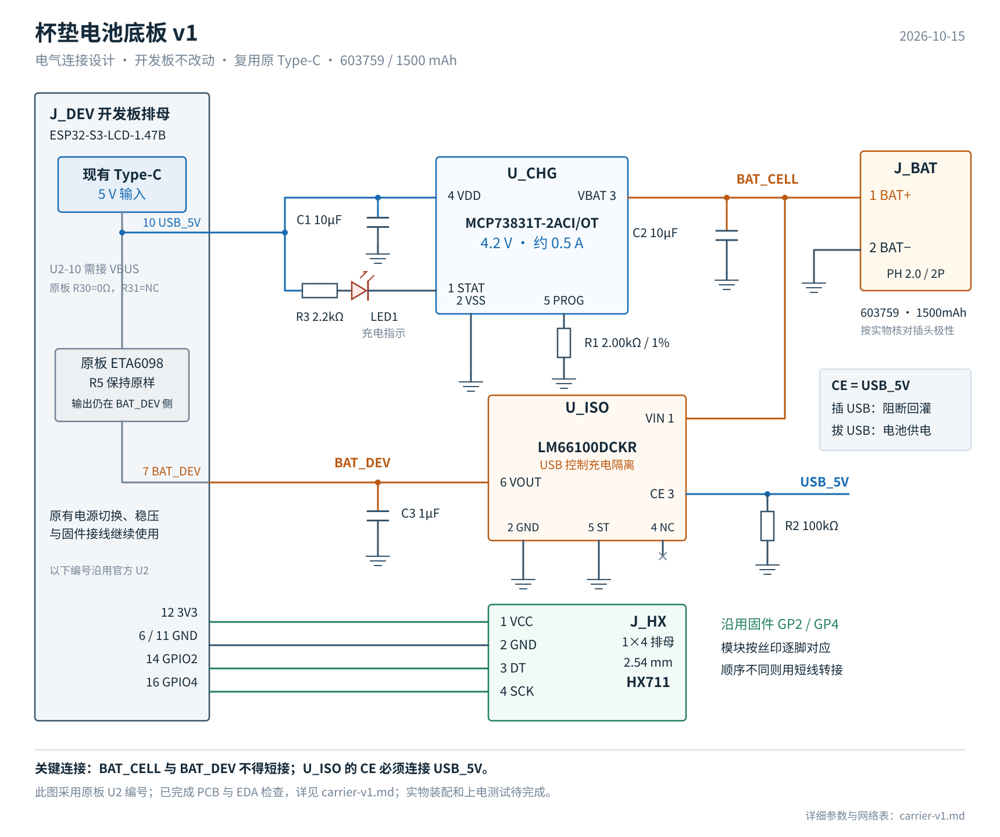

# 电池连接底板 v1

> 2026-10-24：当前版本为 [v1.2：六针直插、同面安装与引脚修正](carrier-v1.1.md)。本页及 v1 制造文件仅保留为历史记录。**下文旧针序 VCC、GND、DT、SCK 与用户已确认的 VCC、SCK、DT、GND 不一致，不能将该模块直接插入旧板。** 新打样须使用 v1.2 文件；已有旧板按信号名称逐根转接。

更新：2026-10-15。已完成嘉立创EDA可编辑原理图、60 × 45 mm 双层 PCB、布局布线和生产资料导出。PCB 严格 DRC 返回空数组，原理图与 PCB 网表逐脚一致。当前为待实物验证的样机设计，尚未打样或进行上电测试。

采用用户最新约束：**不修改开发板，沿用开发板 Type-C，HX711 按普通四针模块设计。** 底板增加独立充电和供电隔离，保留原固件的 GP2 / GP4 接线。

## 工程与交付文件

嘉立创EDA中的最终工程为 **“杯垫电池底板 v1 定稿”**，板子名 `carrier-v1`。导入下列 `.epro2` 可继续编辑原理图和 PCB，工程内包含两款 IC 的自定义符号和封装。

| 文件 | 用途 |
| --- | --- |
| [carrier-v1.epro2](carrier-v1/carrier-v1.epro2) | 完整可编辑工程，以此版本为准 |
| [schematic.pdf](carrier-v1/schematic.pdf) | 原理图，1 页 |
| [pcb.pdf](carrier-v1/pcb.pdf) | 装配布局、BOM、顶层、镜像底层和钻孔图，5 页；不是 1:1 装配模板 |
| [gerber.zip](carrier-v1/gerber.zip) | 双层铜、阻焊、丝印、钢网、板框及钻孔制造文件 |
| [bom.csv](carrier-v1/bom.csv) | 物料清单，13 个元件、12 个条目，UTF-8 编码 |
| [placement.csv](carrier-v1/placement.csv) | 原生导出的元件坐标；贴片前按封装 Pin 1 核对角度 |
| [checks.json](carrier-v1/checks.json) | DRC、ERC、逐脚网表、尺寸和钻孔核对记录 |
| [schematic-netlist.json](carrier-v1/schematic-netlist.json)、[pcb-netlist.json](carrier-v1/pcb-netlist.json) | 两份原生网表，供后续修改复核 |

[底层预览](carrier-v1/pcb-bottom.png)是从底面观察的镜像图；[原理图 PNG](carrier-v1/schematic.png)与 [SVG](carrier-v1/schematic.svg)也已导出。下方旧功能连接图沿用原开发板 U2 编号，具体底板位号和本地脚号以原理图及本文映射表为准。

## 电路设计

- 开发板 Type-C 的 5 V 经原理图 U2-10 引出，给底板充电芯片供电。
- 底板 `U_CHG = MCP73831T-2ACI/OT` 将电池充到标称 4.2 V；`R1 = 2.00 kΩ / 1%` 将恒流阶段设为约 0.5 A。
- 电池正极为 `BAT_CELL`，开发板 BAT 引脚为 `BAT_DEV`，两者之间接 `U_ISO = LM66100DCKR`，不能直接短接。
- LM66100 的 `CE` 接 `USB_5V`，并由 `R2 = 100 kΩ` 下拉。USB 有电时关闭其 MOSFET，阻断开发板原充电器向电池回灌；USB 拔掉后开启，电池向开发板供电。
- HX711 由开发板 3V3 供电，底板不把电池电压直接送到 HX711。

这里复用开发板现有 USB / 电池切换和 3.3 V 稳压。开发板上的 ETA6098 和 R5 保持原样，不再承担这块电池的充电工作。新增电路均位于底板。

## 已确认的电池与接口

| 项目 | 设计输入 |
| --- | --- |
| 开发板 | 微雪 ESP32-S3-LCD-1.47B |
| 电池 | 用户提供：603759、3.7 V、1500 mAh、带保护板 |
| 电池电压 | 用户提供：工作范围 4.2–2.75 V，充电电压 4.2 V |
| 电池电流 | 用户提供：充放电 0.75 A，保护动作电流 2.5–2.8 A；正常充放电暂按不超过 0.75 A 约束 |
| 电池插座 | 按 PH 2.0 mm / 2P 带防呆外壳设计，Pin 1 为 BAT+，Pin 2 为 BAT−；采购和装配仍需核对与用户“2.0 正向”接头的配合及实际极性 |
| HX711 接口 | 1×4、2.54 mm 排母；底板从 Pin 1 起定义为 VCC、GND、DT、SCK |
| 开发板连接 | 两个 1×9、2.54 mm 排母，排距 17.78 mm；按官方 36.37 × 20.32 mm 板外形设计，实物配合待核对 |
| USB 供电 | 沿用开发板 Type-C，充电电源建议采用正规 5 V / 2 A 适配器，为系统与充电同时留余量 |

“普通四针 HX711”并不保证每个卖家的引脚顺序相同。底板按上述顺序标明丝印；装配核对模块 VCC / GND / DT / SCK，顺序不一致时通过短线逐脚转接，不能直接错位插入。本设计不锁定通用 HX711 板的固定孔位。

电池参数来自用户提供，尚无电芯厂商数据表。603759 不代替含保护板和出线的实物外形尺寸；“正向”也不代替接头 Pin 1 的极性核对。

## 为什么需要充电隔离

微雪官方原理图为 `U1 = ETA6098`、`R5 = 82 kΩ`。ETA6098 数据表第 2 页对应典型充电电流约 2 A，超过这块电池给出的 0.75 A。只并联一个 0.5 A 充电器不能限制原有 2 A 充电器。

因此 `BAT_CELL` 与 `BAT_DEV` 分开，由 LM66100 在 USB 存在时关闭两者之间的 MOSFET，阻止原充电器给电池充电。接线方向为 **VIN 接电池，VOUT 接开发板 BAT**。

LM66100 的 CE 是与 VIN 比较的模拟使能端：`CE > VIN + 80 mV` 时保证关闭，`CE < VIN − 250 mV` 时保证开启。本设计将 CE 接 USB 5 V；当 ETA6098 达到其输入工作条件时，CE 已高于电池电压而关闭隔离器件。拔掉 USB 后，R2 把 CE 拉低以启用电池供电。

**CE 不能接地或悬空。** 接地会让 USB 充电时的 MOSFET 仍保持开启，破坏这里的隔离。本设计也不采用 CE 接 VOUT 后等到出现反向电流才触发的连接方式。

LM66100 内部保留从 VIN 到 VOUT 的体二极管，关闭时仍可能向开发板方向正向导通；它在此处的作用是阻断开发板到电池的反向充电，不是双向断电开关。USB 插拔瞬间的反向电流、时序和电压波形仍须测量，不能把稳态分析当作瞬态验证。

## 充电设定与指示

MCP73831 数据表的公式为 `IREG(mA) = 1000 / RPROG(kΩ)`。R1 取 2.00 kΩ，标称为 500 mA。数据表给出该阻值的充电电流范围为 450–550 mA（规定测试温度下，设计保证而非逐颗测试）；计入 1% 电阻误差估算上界约 556 mA，仍低于 750 mA。这个计算不代替样机测量和完整温度条件下的验证。

充电芯片选用 **4.2 V 的 `-2` 版本**，不能换成 4.35 V / 4.4 V / 4.5 V 版本。输入和电池侧电容在工作偏压下需保持至少 4.7 µF 有效容量。

LED1 从 USB_5V 经 R3 接到 STAT，用于显示底板实际充电状态。亮表示底板正在充电；灭也可能是未接 USB 或没有电池，不能单凭熄灭判定充满。开发板原充电灯和原 BAT_ADC 测的是隔离后的 BAT_DEV，USB 连接时不能用它们判断本电池的充电状态或电量。

MCP73831 是线性充电芯片；散热不足时会降低充电电流。以 5 V 输入、电池 3.0 V、0.5 A 估算，芯片耗散约 1 W，SOT-23-5 封装可能进入热调节。布板需给散热留铜面积并实测温升，不承诺全程维持 0.5 A，也不据此承诺充满时间。

## 底板网络与引脚

底板使用 `J_DEV_A`、`J_DEV_B` 两个排母，每个独立编号 1–9。`J_DEV_A-1…9` 对应原板 `U2-1…9`；`J_DEV_B-1…9` 对应原板 `U2-10…18`。所有 GND 共地。

| 网络 | 连接点 |
| --- | --- |
| USB_5V | J_DEV_B-1（原板 U2-10）；U_CHG-4 / VDD；U_ISO-3 / CE；C1-1；R2-1；R3-1 |
| BAT_CELL | J_BAT-1；U_CHG-3 / VBAT；U_ISO-1 / VIN；C2-1 |
| BAT_DEV | J_DEV_A-7（原板 U2-7）；U_ISO-6 / VOUT；C3-1 |
| GND | J_DEV_A-6、J_DEV_B-2；J_BAT-2；J_HX-2；U_CHG-2 / VSS；U_ISO-2 / GND、U_ISO-5 / ST；C1-2、C2-2、C3-2；R1-2、R2-2 |
| PROG | U_CHG-5；R1-1 |
| LED_A | R3-2；LED1-2 / A |
| CHG_STAT | U_CHG-1 / STAT；LED1-1 / K |
| 3V3 | J_DEV_B-3（原板 U2-12）；J_HX-1 / VCC |
| HX_DT | J_DEV_B-5（原板 U2-14 / GPIO2）；J_HX-3 / DT |
| HX_SCK | J_DEV_B-7（原板 U2-16 / GPIO4）；J_HX-4 / SCK |
| 不连接 | U_ISO-4 / NC；J_DEV_A、J_DEV_B 的其余未使用排针，共 12 个 NC |

本设计要求开发板原理图上的 **R30 为 0Ω、R31 不装**，使 U2-10 接 VBUS。装配前核对实际板卡版本与 U2-10 到 USB VBUS 的导通关系；不能把 VSYS 当作这里的 USB_5V。若板卡版本不符合这一默认配置，须重新确定取电接口，不能直接照接。

## 器件表

| 位号 | 器件 / 参数 | 封装或接口 | 立创料号 | 数量 |
| --- | --- | --- | --- | ---: |
| U_CHG | MCP73831T-2ACI/OT，4.2 V | SOT-23-5，自定义封装 | 未指定，按完整型号选购 | 1 |
| U_ISO | LM66100DCKR | SC-70-6 / DCK，自定义封装 | 未指定，按完整型号选购 | 1 |
| R1 | 0603WAF2001T5E，2.00 kΩ，1% | 0603 | C22975 | 1 |
| R2 | 0603WAF1003T5E，100 kΩ，1% | 0603 | C25803 | 1 |
| R3 | 0603WAF2201T5E，2.2 kΩ，1% | 0603 | C4190 | 1 |
| C1、C2 | CL21B106KOQNNNE，10 µF / 16 V，X7R | 0805 | C95841 | 2 |
| C3 | CL10B105KO8NNNC，1 µF / 16 V，X7R | 0603 | C59782 | 1 |
| LED1 | 17-21SURC/S530-A2/TR8，红色 | 0805；Pin 1 为阴极 | C131244 | 1 |
| J_BAT | B2B-PH-K-S(LF)(SN)，PH 2.0 mm / 2P | 直插；Pin 1 正极，Pin 2 负极 | C131337 | 1 |
| J_HX | 1×4、2.54 mm 排母 | 直插 | C2718488 | 1 |
| J_DEV_A、J_DEV_B | 1×9、2.54 mm 排母 | 直插 | C39576 | 2 |

位号只用于底板；U_CHG / U_ISO 与开发板已有的 U1 / U2 不混用。电池、开发板、HX711 复用现有实物，不计入新增元件。供应商库存未核实。C1/C2 的型号已录入工程，但仍需按厂商偏压、温度和容差曲线确认工作时有效容量至少 4.7 µF，不能只凭标称 10 µF 判定。

## PCB 尺寸与装配

- 板框 60 × 45 mm，双面布线和 GND 铺铜；建议样机采用 FR-4、1.6 mm 板厚、1 oz 铜，工厂订单参数需另外设置，Gerber 本身不规定这些参数。
- 从顶层看，开发板 LCD 朝上、Type-C 朝左。原板外形位于 `x=0…36.37 mm、y=23…43.32 mm`，上排 `J_DEV_B`、下排 `J_DEV_A`。排母排距 17.78 mm，针距 2.54 mm。
- **上下两排编号方向相反。** 上排从左到右为原板 U2-10…18；下排从左到右为原板 U2-9…1。PCB 已在两端标注原板编号，不能将两个排母都按同一方向装开发板。
- 四个底板安装孔为 3.2 mm 非金属化孔，坐标 `(3,3)、(57,3)、(3,21)、(57,21) mm`，原点是底板左下角；这些不是开发板安装孔。
- 排母成品孔径约 1.1 mm，电池座约 1.0 mm，过孔约 0.3 mm。电源主干 0.6 mm，IC 引脚短引出段 0.25 mm，3V3 主干 0.4 mm，HX711 信号线 0.25 mm。
- 两面天线禁铜、禁走线、禁器件区域为 `x=29…60 mm、y=26…40.5 mm`；USB 净空为 `x=0…8.2 mm、y=29…37.2 mm`。不要把电池、金属紧固件或金属外壳放进天线区域。
- `BAT_CELL` 与 `BAT_DEV` 为独立网络；电池座不得再通过另一根线直接接原板 BAT 插座或 BAT 引脚，否则绕过隔离。
- HX711 接口从左到右为 VCC、GND、DT、SCK。未知模块外形不支持直接锁定安装孔；实际针序不同则用短线逐脚转接。
- 两款 IC 的 Pin 1 丝印圆点均位于各自封装右下方；焊接和贴片须以圆点、焊盘编号及芯片标记共同核对，不能仅凭坐标文件的 0° 判断方向。
- 传感器按原有独立受力结构安装；底板、电池与线束不分担杯子载荷，电池不贴靠充电芯片热区。电池外形、排母高度和外壳固定方式仍需实物确认。

## 已验证内容与样机边界

已对最终工程完成下列检查，记录见 `checks.json`：

1. PCB 严格 DRC 返回 `[]`，两面 GND 铺铜均已重建，导出 Gerber 中包含实际铜区。
2. 原理图与 PCB 的 13 个元件、37 个有网络引脚逐一一致，并与设计引脚表一致；另有 12 个 NC。
3. 原理图 ERC：致命错误 0、错误 0、警告 1。警告为 11 个库器件的属性与供应商编号不完全匹配，来自中文用途/参数名称；另有 6 个位号命名格式提示。保留现有清晰用途位号，未盲目更新器件库。
4. 已核对导出文件的 60 × 45 mm 板框、22 个约 1.1 mm 排母孔、2 个约 1.0 mm 电池座孔、24 个约 0.3 mm 过孔、4 个 3.2 mm NPTH，以及两面天线和 USB 净空。
5. 已查看最终原理图 PDF 和 PCB 各有效页面，工程 ZIP 和 Gerber ZIP 可正常解包。没有上传厂商 DFM、下单、装配或真机验收。

实物到位后的顺序：先断开电池和 USB，核对电池插头极性、开发板 R30/R31 配置、两排方向、排母高度和固定空间；再用限流电源验证供电及两电池网络间没有旁路；随后测量 USB 输入/插拔瞬态电压与电池反向电流、稳态充电电流和终止、温升、Wi-Fi 发射与亮屏峰值电流及 3V3 稳定性。输入浪涌保护能力尚未验证，不能以 DRC 通过代替这些测量。电池保护阈值不替代正常工作电流限值。

电池最低工作电压 2.75 V 低于开发板 3.3 V 稳压的输入需求；低电时的稳定工作范围和续航必须实测。本轮不修改固件或增加电量显示。

## 核对来源

- [微雪官方原理图](https://files.waveshare.com/wiki/ESP32-S3-LCD-1.47B/ESP32-S3-LCD-1.47B_schematic_diagram.pdf)：USB、Power、BAT 和 U2，R30 / R31 配置。
- [ETA6098 V1.1 数据表](https://www.eta-semi.com/wp-content/uploads/2022/03/ETA6098_V1.1.pdf)：第 2 页充电电流与输入工作条件。
- [Microchip MCP73831/2 DS20001984H](https://ww1.microchip.com/downloads/en/DeviceDoc/MCP73831-Family-Data-Sheet-DS20001984H.pdf)：第 3 页电气参数，第 11 页引脚，第 15 页电流公式与状态，第 17–18 页散热及应用。
- [TI LM66100 SLVSEZ8A](https://www.ti.com/lit/ds/symlink/lm66100.pdf)：第 3 页引脚、第 5 页电气参数、第 8 页 CE 工作条件和内部体二极管方向。
- [现有接线表](wiring.md)与 [固件引脚配置](../../firmware/water_companion/board_config.h)。
